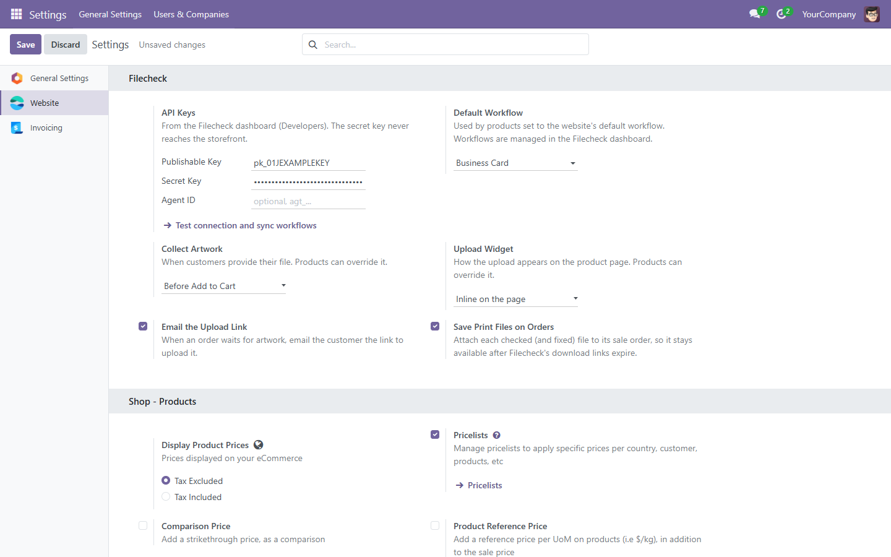
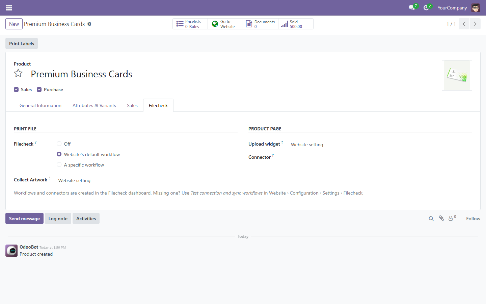
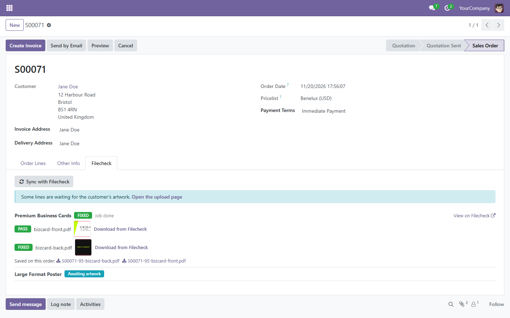

The Filecheck module puts the Element on your Odoo product pages, gates **Add to cart** until the file passes, and saves the print-ready files on the sale order. It works with Odoo **17 and 18** with the **eCommerce** app, self-hosted or on Odoo.sh.

<CardGroup cols={2}>
  <Card title="Odoo 18 on the Apps Store" icon="store" href="https://apps.odoo.com/apps/modules/18.0/filecheck">
    The official listing for Odoo 18. Free, LGPL-3.
  </Card>
  <Card title="Odoo 17 on the Apps Store" icon="store" href="https://apps.odoo.com/apps/modules/17.0/filecheck">
    The official listing for Odoo 17. Free, LGPL-3.
  </Card>
</CardGroup>

<Note>
  Odoo Online (the SaaS at odoo.com) cannot install third-party modules. Use a self-hosted Odoo or Odoo.sh.
</Note>

<Steps>
  <Step title="Install the module">
    Download the module for your Odoo version from the Odoo Apps Store ([Odoo 18](https://apps.odoo.com/apps/modules/18.0/filecheck) or [Odoo 17](https://apps.odoo.com/apps/modules/17.0/filecheck)) and extract the `filecheck` folder into your addons path. On Odoo.sh, add the [GitHub repository](https://github.com/PrintApp/filecheck-odoo) as a submodule on the branch that matches your Odoo version (`18.0` or `17.0`).

    Restart Odoo, open **Apps**, click **Update Apps List**, search for **Filecheck** (remove the default **Apps** filter if it does not show), and click **Activate** on **Filecheck Print File Preflight**. It installs Odoo's eCommerce app too if you do not have it yet.
  </Step>
  <Step title="Add your keys">
    Go to **Website → Configuration → Settings** and scroll to the **Filecheck** section. Enter your **publishable key** and **secret key** from the [Dev Hub](https://admin.filecheck.io/devhub), click **Save**, then click **Test connection and sync workflows**. Your workflows and connectors load into the dropdowns. Pick a **Default Workflow** and save.

    <Frame>
      
    </Frame>
  </Step>
  <Step title="Enable Filecheck on a product">
    Open a product and go to its **Filecheck** tab. Set **Filecheck** to **Website's default workflow**, or choose **A specific workflow** and pick it. Products are off until you switch them on. Optionally set **Collect Artwork**, the **Upload widget** (inline or a button that opens a dialog) and a [Connector](/element/connectors).

    <Frame>
      
    </Frame>
  </Step>
  <Step title="Test the gate">
    Open the product page. The upload sits above **Add to cart**, which stays disabled until the file passes. Upload a test file, add the product to the cart and check out. The cart line shows the file name, and each uploaded file gets a cart line of its own.
  </Step>
  <Step title="Find the files on the order">
    When the order is confirmed, it is sent to Filecheck. Open the sale order and go to its **Filecheck** tab: each line shows its outcome, proofs and download links, with **View on Filecheck** to open the job. Once the job has finished, its files are attached to the order, with a note in the chatter.

    <Frame>
      
    </Frame>
  </Step>
</Steps>

<Tip>
  Running several websites from one database? Keys and defaults are stored per website. Pick the website at the top of the Settings page and configure each one.
</Tip>

## Artwork after checkout

The module lets customers pay first and upload their artwork later, on your own upload page. See [Artwork after checkout](/configuration/artwork-after-checkout) for the whole feature.

<Steps>
  <Step title="Set up your upload page">
    In Filecheck, go to **Settings → Artwork after checkout**, set an **Upload Page Address**, and add your logo and colours.
  </Step>
  <Step title="Choose when to collect artwork">
    In the Filecheck section of the website settings, set **Collect Artwork** for the whole store: **Before Add to Cart** (at checkout), **Before or after checkout** (optional, or after checkout) or **After checkout** (after checkout only). To change one product, use **Collect Artwork** on the product's **Filecheck** tab. The module's setting decides both the product page and which order lines wait for artwork.
  </Step>
  <Step title="Choose how customers get the link">
    The link shows on the order confirmation page and on the customer's order page in their portal. With **Email the Upload Link** on, customers also get one **Upload your artwork** email when the order is confirmed. Edit its wording in the **Filecheck: Upload your artwork** email template.
  </Step>
</Steps>

Files customers upload on the upload page land on their order lines in Odoo within about 30 minutes, and are saved on the order like any other.

<Note>
  Only confirmed sales orders get an upload page: quotations and cancelled orders never do. If the upload cannot run on the product page (for example when Filecheck cannot be reached), the customer can still order. That line then waits for artwork after checkout, and the customer gets the upload link, whatever the product's setting.
</Note>

<Tip>
  How the module talks to Filecheck, for developers: see the [Odoo reference](/integrations/odoo).
</Tip>
